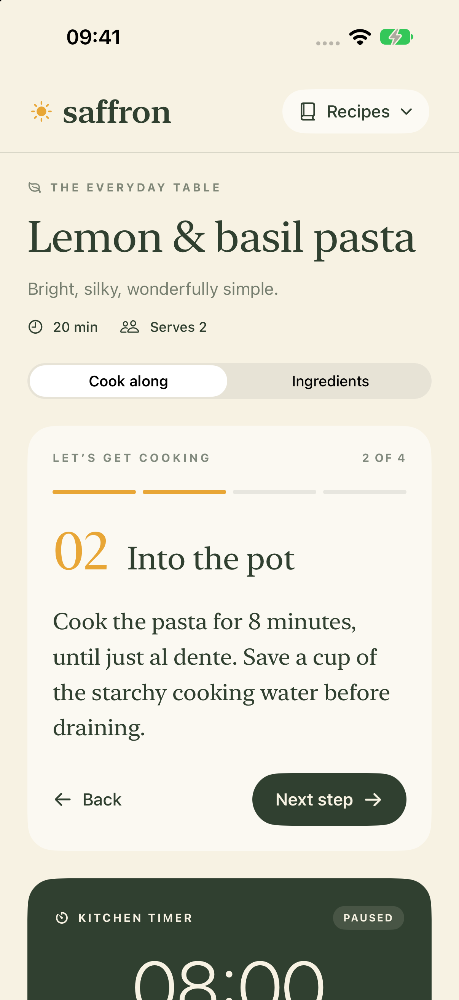
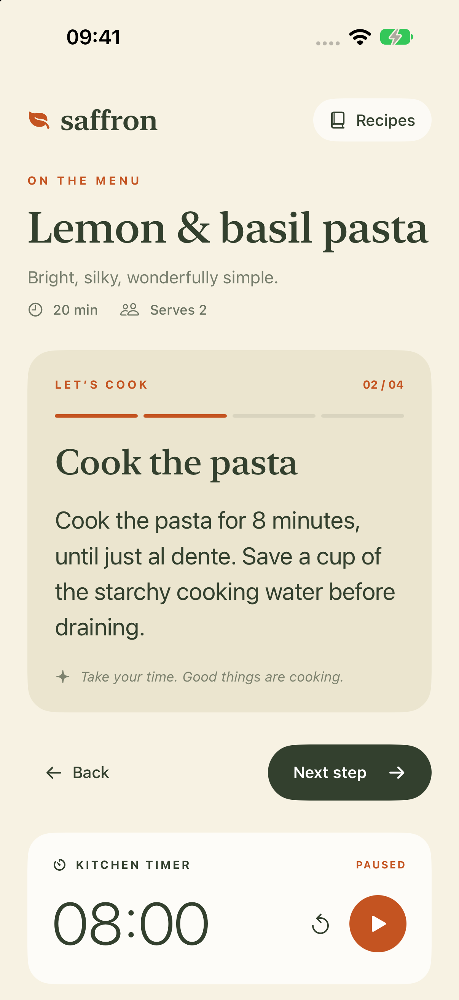
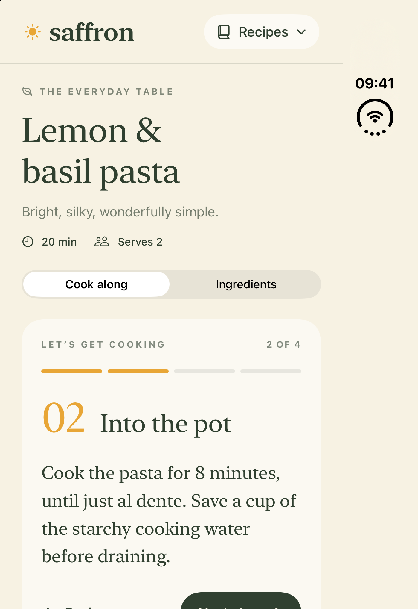
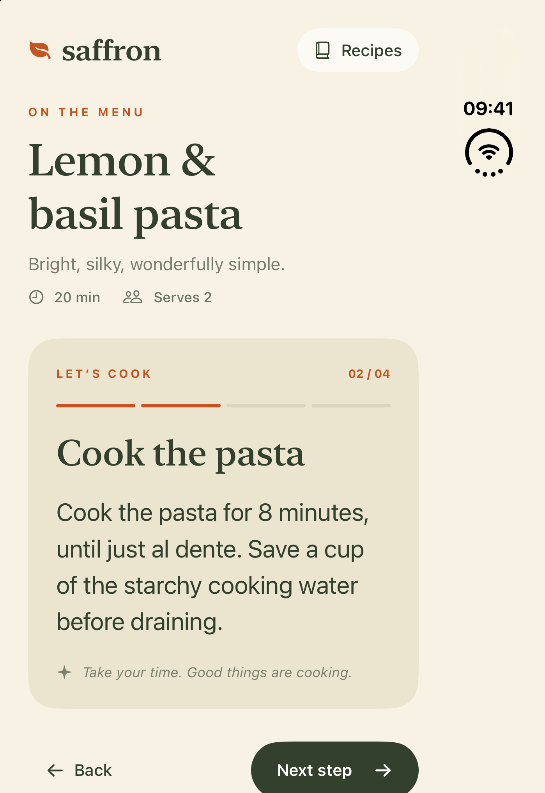
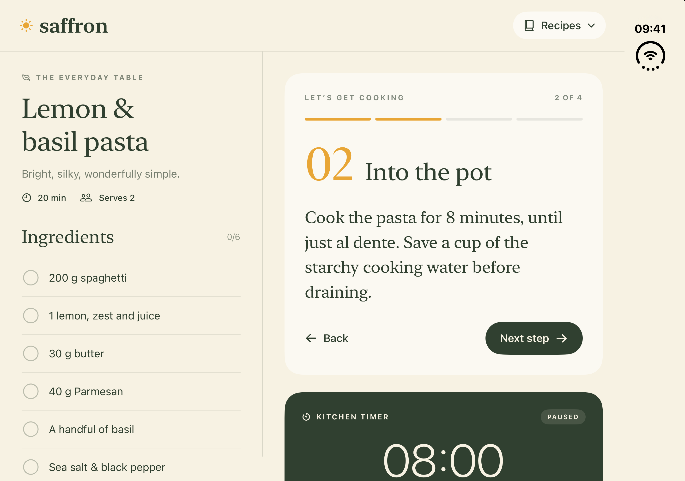
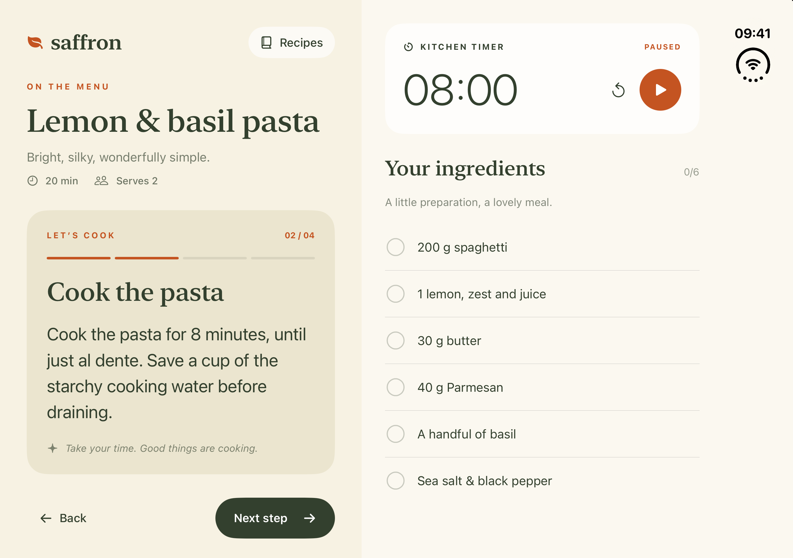
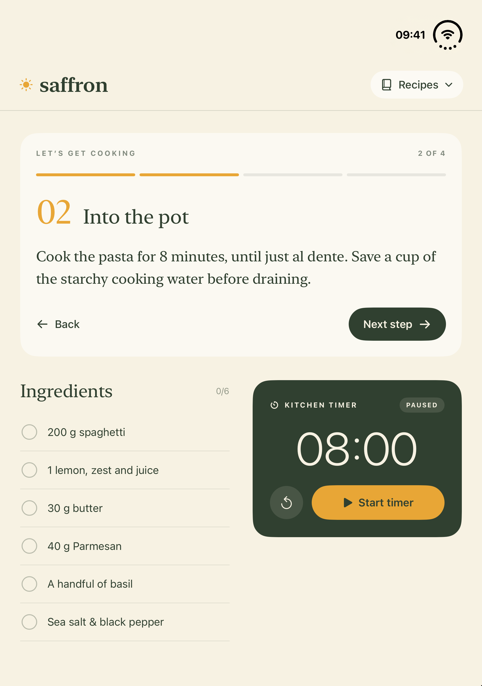
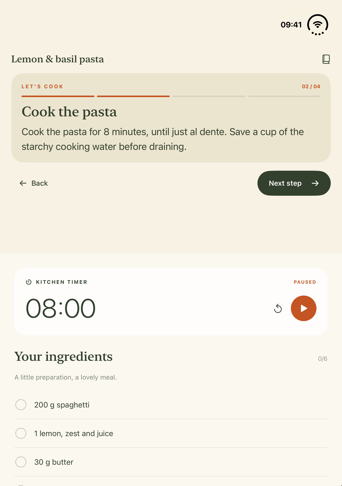

# iPhone Duo Composition

A portable agent skill for turning iPhone Duo's space and folding capabilities into useful iOS experiences—while keeping ordinary iPhone screens familiar.

Pair an instruction with its controls, a source with its draft, or a selection with its consequence. The skill helps choose when a second region improves the task and when one continuous surface is the better design.

## Install

```sh
npx skills add tn/iphone-duo-composition-skill --skill iphone-duo-composition
```

The skill uses the standard `SKILL.md` format. It has no agent-specific metadata, tool integration, third-party library requirement, or dependency on another skill. You can also copy the [iphone-duo-composition](iphone-duo-composition/) folder into your agent's supported skills directory.

## Use

> Use iphone-duo-composition to adapt this screen for Duo. Find a useful relationship between the current task and its context. Preserve the ordinary iPhone experience and the app's visual language.

> Design a hands-free practice screen that works open, partly folded, and closed. Keep the current cue visible and the controls reachable.

> Review this Duo composition. Does the extra region help the task, and does the active content still fit after folding?

The entrypoint stays short. Supporting references cover [composition choices](iphone-duo-composition/references/composition.md), [SwiftUI and UIKit implementation](iphone-duo-composition/references/platform.md), and [primary sources](iphone-duo-composition/references/sources.md). It distinguishes two regions on the inner display, continuity between displays, and supported simultaneous-display accessories.

Duo-specific examples target iOS 27.1 APIs with availability guards. Existing apps keep their deployment target. API declarations were checked against Xcode 27.2 on November 9, 2026, and the included SwiftUI composition example passed compiler type checking.

## Visual comparison

**Model: Astra Light.** Same model configuration, same brief, same starter, and the same work limits in both arms. Baseline: no skills. Treatment: only this skill. No other design or implementation skills were used by the generating agents.

The small Saffron recipe app uses only local data, SwiftUI, shapes and SF Symbols. Both versions launch on lemon pasta, step 2, with an 08:00 paused timer. The evaluation covers final visuals only: no automated tests, VoiceOver checks, large-font checks, or additional audits.

Two rounds are retained. The first treatment exposed a short-pane hierarchy problem; the skill was refined, then **both arms were regenerated independently**. No generated app received manual visual improvements. See the [method and reproduction instructions](evaluation/README.md), [shared brief](evaluation/prompt.md), and [first-round results](evaluation/round-1/).

### What the final images show

| Configuration | Observation |
| --- | --- |
| Ordinary iPhone | Both retain readable single-column cooking screens. The treatment shows the complete timer in the initial viewport; the baseline's timer extends below it. |
| Duo outer display | Both keep the step readable. The treatment exposes more of the step navigation near the bottom; its timer still requires scrolling. |
| Duo open | The treatment shows the instruction, step controls, timer controls and all six ingredients together. The baseline gives the instruction more width, but its timer controls fall below the initial viewport. |
| Horizontal fold | Both show the current instruction above the fold. The treatment now condenses the introduction and separates the lower timer/context pane. The baseline displays all six ingredients at once; the treatment shows fewer ingredients and requires scrolling for the rest. |

The clearest improvement is simultaneous task/context visibility on the open display. The folded view has a real tradeoff: the treatment respects the pane boundary and keeps the task visible, but uses its lower area less densely. These screenshots do not establish a universal winner or prove state continuity. All four generated projects compiled successfully; no functional correctness claim is made.

### iPhone 18 Pro · portrait

| Without skill | With skill |
| --- | --- |
|  |  |

### Duo · outer display

| Without skill | With skill |
| --- | --- |
|  |  |

### Duo · fully open

| Without skill | With skill |
| --- | --- |
|  |  |

### Duo · partial horizontal fold

These are unedited framebuffer screenshots from the partially open simulator pose. The physical bend is not painted onto the exported pixels.

| Without skill | With skill |
| --- | --- |
|  |  |

## Sources and license

Based on Apple's [Duo preparation guide](https://developer.apple.com/iphone-duo/prepare/), [Human Interface Guidelines](https://developer.apple.com/design/human-interface-guidelines/designing-for-iphone-duo), [adaptive layout session](https://developer.apple.com/videos/play/tech-talks/111463/), and [displays and scenes session](https://developer.apple.com/videos/play/tech-talks/111464/), plus generalized lessons from an existing workout app. No private application code or data is included.

[MIT](LICENSE) covers the original skill, documentation and demonstration source. Apple documentation remains available at its original links.
